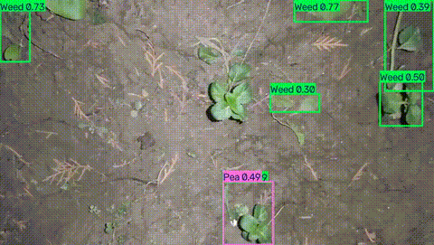
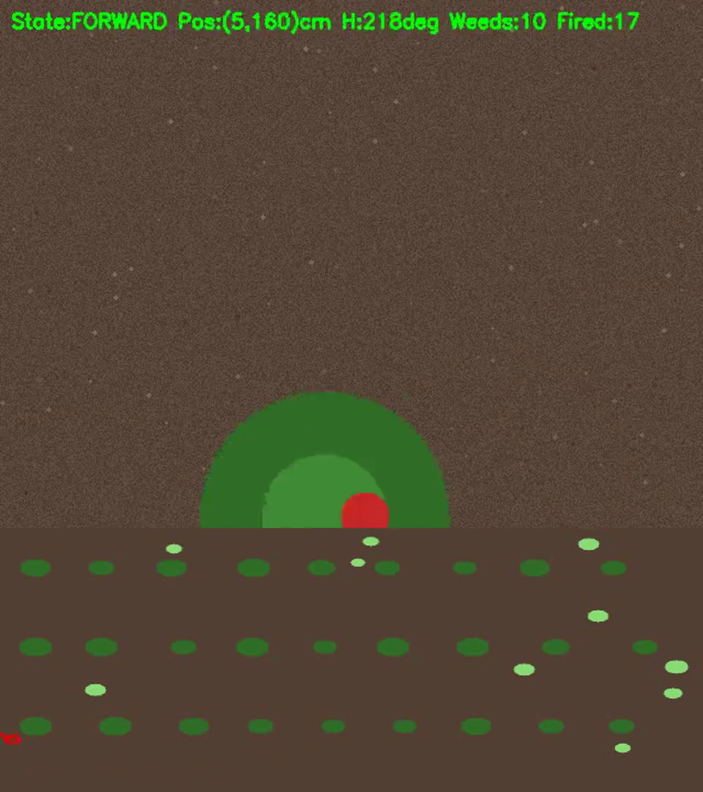

# Semi-Autonomous Weeding Robot

A weed-detection and precision-elimination agricultural robot. Two operational generations in one repository:

1. **Project-RIPRA / Weed_Detection** — original gantry on rails: camera detects weeds, gantry moves in X/Y, laser fires at fixed Z.
2. **Navigation/ & weed_detection_bot/** — current design: an autonomous wheeled **rover** that navigates crop furrows using edge vision (YOLOv8 + MaixSense-A075V 3D Depth camera), executes Boustrophedon serpentine field coverage, and eliminates weeds with a co-axial rotating turret (mechanical grinder / thermal flame).

---

## 📱 End-to-End Workflow: From Phone Image to Autonomous Field Execution

```
[Phone App Photo] ──► [4-Corner Tap & Dimensions] ──► [OpenCV BEV Homography]
         │                                                    │
         ▼                                                    ▼
 [Upload via Wi-Fi/Hotspot]                            [Crop Rows Detected]
         │                                                    │
         ▼                                                    ▼
[Raspberry Pi 5 Server] ◄────────────────────── [Boustrophedon Waypoints Generated]
         │
         ├──► [MaixSense-A075V Depth (30°)] ──► Real-Time Furrow Centering (±25mm)
         │                                      & Headland Row-End Corner Detection
         │
         ├──► [YOLOv8 best.pt Edge AI]       ──► Weed Cut Coordinates (X_ground, Y_fwd)
         │                                      & Monotonic Priority Queue (Band Sweep)
         │
         ├──► [Passive Canopy Scanner]       ──► Healthy vs. Sick Chili Foliage
         │                                      & Auto-Records 3s MP4 Evidence Clips
         │
         ├──► [FastAPI Live Dashboard]       ──► /video_feed, /map_feed, /cut_plan
         │                                      Streamed to Phone in Real Time
         │
         ▼ (UART Serial /dev/ttyUSB0 @ 115200)
[ESP32 Motor & Turret Controller]
         ├── 8-Direction Drive : 0° (Fwd), 45°/315° (Steer), 90°/270° (U-Turn Pivot), 180° (Rev)
         ├── Turret Yaw Servo  : Aims 120° Sector Gear (-35° to +35°) Directly Over Stem Base
         └── Dual Relay Board  : Relay 1 (Grinder Motor) / Relay 2 (Thermal Flame Solenoid)
```

### Detailed Step-by-Step Execution

#### Step 1: Field Capture & Bird's-Eye-View (BEV) Transformation (Android App)
1. **Take an Angled Photo**: The farmer snaps a photo of the crop field using the Android app camera (`android_app/`).
2. **Select 4 Corners & Enter Dimensions**: Tap the 4 boundary corners of the field plot and input the physical dimensions (e.g., $8\text{ m} \times 6\text{ m}$).
3. **OpenCV Perspective Warp (Homography)**: The app runs `cv2.warpPerspective` to flatten the perspective-skewed image into a scaled, top-down 2D Bird's-Eye-View (BEV) grid where $1\text{ pixel} = X\text{ cm}$.
4. **Crop Row Extraction**: `FieldAnalyzer.kt` computes Excess Green (`ExG = 2G - R - B`) and Otsu thresholding to identify parallel green crop ridges vs. walkable furrows.

#### Step 2: Global Mission Planning & Transmission
1. **Boustrophedon Coverage Plan**: `BoustrophedonGenerator.kt` connects the detected rows into an alternating serpentine traversal pattern with headland turning margins.
2. **Sync to Raspberry Pi**: The phone connects to the rover's Wi-Fi hotspot and HTTP POSTs the mission JSON (`/image` or `/mission`) to the onboard server (`Navigation/sim/mission_server.py` or `pi_boustrophedon_brain.py`).

#### Step 3: Local 3D Depth Navigation & Corner Tracking (MaixSense-A075V)
1. **Pitched 3D Elevation Slicing**: The MaixSense-A075V is mounted at $20\text{ cm}$ height, angled $30^\circ$ downward. Its $320 \times 240$ millimeter depth matrix projects onto a local height grid.
2. **Crop Walls vs. Furrow Floor**: Crop ridges stand $>60\text{ mm}$ above the furrow soil. The Pi measures left vs. right wall distance:
   $$\text{steer\_error} = \text{dist}_{\text{left}} - \text{dist}_{\text{right}}$$
3. **8-Way Heading Command**:
   * $|\text{error}| \le 25\text{ mm} \implies \mathbf{0^\circ}$ (Drive straight ahead).
   * $\text{error} < -25\text{ mm} \implies \mathbf{45^\circ}$ (Veer slightly right).
   * $\text{error} > +25\text{ mm} \implies \mathbf{315^\circ}$ (Veer slightly left).
4. **Headland Corner Detection**: When crop walls terminate ahead ($\text{max\_wall\_y} < 520\text{ mm}$), the Pi triggers a row-end turn:
   * **Odd rows**: Command $\mathbf{90^\circ}$ (In-place pivot right).
   * **Even rows**: Command $\mathbf{270^\circ}$ (In-place pivot left).
   * The rover shifts laterally across the headland ($0^\circ$ for row spacing) and locks into the next furrow corridor.

#### Step 4: YOLOv8 Weed Detection & Target Prioritization
1. **Trained YOLOv8 Weights (`best.pt`)**: Detects weed instances at 12–18 FPS directly on the Pi.
2. **$30^\circ$ Stem Base Geometry**: Converts pixel coordinates $[x_1, y_1, x_2, y_2]$ and depth $D$ into ground millimeters:
   $$X_{\text{ground}} = \frac{(u - 160) \cdot D}{280}, \quad Y_{\text{fwd}} = D \cos(30^\circ) - Y_c \sin(30^\circ)$$
3. **Monotonic Priority Queue ("Which to Cut First")**:
   * Weeds are grouped into $30\text{ mm}$ forward distance bands.
   * The rover visits the closest band first, sweeping the cylinder turret with minimum rotation slew before driving forward to the next band.

#### Step 5: Passive Crop Health Surveillance (Bad-Chili Detection)
1. **3D Crop Ridge Isolation**: The scanner inspects elevated side foliage ($|X| > 80\text{ mm}, Z > 80\text{ mm}$) outside weed bounding boxes.
2. **Chlorosis/Necrosis Ratio**: Fast HSV color ratio checks for yellowing mosaic virus or brown blight.
3. **Evidence Video Recording**: When unhealthy foliage is spotted ($>28\%$ bad ratio), the Pi automatically extracts the last 3 seconds from its rolling frame buffer and saves an MP4 video clip + JPG snapshot into `bad_chilli_clips/` while pinning a warning marker on the live map.

#### Step 6: Rover Actuation & Cutting Execution (ESP32)
1. **Approach**: The rover drives forward until $\text{drive\_to\_cut} \le 15\text{ mm}$ (weed stem directly under the tool ring).
2. **Aim Turret**: The Pi commands `TURRET <deg>`, rotating the MG996R sector gear to center the tool directly over the stem base.
3. **Eliminate**: The Pi sends `CUT <GRINDER|FLAME> <duration_ms>`, triggering Relay 1 (high-speed rotary grinder) or Relay 2 (thermal flame valve) to destroy the weed without damaging crop roots.
4. **Resume**: The rover immediately rotates to the next weed in the same band, or drives forward along the planned Boustrophedon route.

---

## Demo videos

| Video / Demo | What it shows |
|--------------|---------------|
| [test_video.mp4](weed_detection_bot/videos/test_video.mp4) | Real-world field camera weed detection test run with YOLOv8 |
| [rover_weeding_anim.mp4](Navigation/sim/rover_weeding_anim.mp4) | Blender 3D animation of the rover weeding a field |
| [field_sim_mission.mp4](Navigation/sim/field_sim_mission.mp4) | Full autonomous mission in the Python field simulator: the rover drives the rows, scans with its virtual camera, aims the gimbal and fires the laser at every weed (minimap below shows live position) |

### Weed Detection Field Test


*Preview from `weed_detection_bot/videos/test_video.mp4` evaluated with YOLOv8 model.*



## Repo layout

```
Navigation/            the rover (current focus)
├── src/
│   ├── state_machine.py     IDLE→FORWARD→STOP→SCAN→AIM→FIRE loop
│   ├── row_navigator.py     row-following, row-end turns, serpentine coverage
│   ├── rover_motors.py      DC motor control via ESP32 serial
│   ├── servo_gimbal.py      pan-tilt servo aiming (real + simulator)
│   ├── ultrasonic.py        VL53L0X / HC-SR04 distance readings
│   ├── esp32_bridge.py      serial protocol Pi ↔ ESP32
│   └── field_simulator.py   virtual field: soil, crop rows, weeds, ToF, camera
├── esp32_firmware/          firmware for the ESP32 motor/servo driver
├── sim/                     virtual-field runner, Blender scene, videos
│   ├── run_field_sim.py     run a full mission headless / live / recorded
│   ├── build_field_scene.py Blender 3D field + rover scene
│   └── rover_weeding_anim.mp4, field_sim_mission.mp4
├── rover_config.yaml        pins, speeds, thresholds, serial port
└── ROADMAP.md               architecture shift, budget, week plan

Weed_Detection/         detection pipeline + laser control (reused by the rover)
weed_detection_bot/     autonomous edge AI + cloud retraining weed detection bot (YOLOv8 + Pi 5 + ESP32)
Project-RIPRA/          original gantry-era project material
case_study/             supporting case study material
```

## FreeCAD simulation (real CAD rover + field)

`Navigation/sim/freecad_field_sim.py` builds the mission in **FreeCAD** using
the real chassis model from `weed_robot_chassis.FCStd` (scaled mm -> m):

* 6 x 8 m field, 9 crop rows of plants, 27 weeds
* the rover: 33 real CAD parts (TT gearboxes, DC motors, 4 wheels, bridges)
* the boustrophedon coverage path in red
* the rover drives the rows, spinning its wheels and firing the laser at
  every weed it passes

```bash
# inside FreeCAD (GUI) - build + animate + save frames
freecad                                  # then in the Python console:
#   import sys; sys.path.append("<repo>/Navigation/sim")
#   import freecad_field_sim as sim; sim.build_scene_and_animate()

# headless (geometry only)
./FreeCAD.AppImage --console Navigation/sim/freecad_field_sim.py
```

Video: `Navigation/sim/freecad_weeding_mission.mp4` (180 frames, top view).

## Run the virtual mission (no hardware needed)

```bash
# headless mission + recorded video (rover camera view on top, minimap below)
python3 Navigation/sim/run_field_sim.py --record Navigation/sim/field_sim_mission.mp4

# live OpenCV view ('q' to quit)
python3 Navigation/sim/run_field_sim.py --view

# different field layout
python3 Navigation/sim/run_field_sim.py --seed 7
```

The simulator wires the real `RoverStateMachine` into a virtual 3x2 m field,
so the exact code that will run on the rover is what gets exercised here.

## Hardware stack

```
MaixSense-A075V (20cm, 30° down) ─── USB ───► Raspberry Pi 5
                                               ├── YOLOv8 weed detection (best.pt)
                                               ├── 3D BEV furrow tracking & headland corners
                                               ├── Passive chili canopy health scanner
                                               ├── Boustrophedon map generator
                                               ├── FastAPI server → /video_feed /map_feed /cut_plan
                                               └── ESP32 (Serial /dev/ttyUSB0 @ 115200)
                                                         ├── 8-way direction: 0/45/90/135/180/225/270/315°
                                                         ├── Turret yaw servo (MG996R, 120° sector gear)
                                                         └── Relay 1: Grinder motor / Relay 2: Flame valve
```

| File | Purpose |
|------|---------|
| [`weed_detection_bot/pi_brain/pi_boustrophedon_brain.py`](weed_detection_bot/pi_brain/pi_boustrophedon_brain.py) | Main Pi runtime — weed targeting, navigation, canopy scanner, map server |
| [`weed_detection_bot/video_test.py`](weed_detection_bot/video_test.py) | Offline YOLOv8 test on `test_video.mp4` |
| [`weed_detection_bot/yolo_models/best.pt`](weed_detection_bot/yolo_models/best.pt) | Your trained YOLOv8 weed detection weights |
| [`weed_detection_bot/yolo_models/smartweeder_best.pt`](weed_detection_bot/yolo_models/smartweeder_best.pt) | Upstream SmartWeeder weights (alternate) |
| [`weed_detection_bot/esp32_code/allmotor_control.ino`](weed_detection_bot/esp32_code/allmotor_control.ino) | ESP32 firmware — servo, relay, serial command parser |
| [`weed_detection_bot/pi5_code/raspberry_pi_prog.py`](weed_detection_bot/pi5_code/raspberry_pi_prog.py) | Standalone Pi detection + GPIO runner (no MaixSense) |
| [`weed_detection_bot/cloud_trainer/app.py`](weed_detection_bot/cloud_trainer/app.py) | Streamlit annotation & Kaggle retraining pipeline |
| [`urdf/weed_laser_robot.urdf.xacro`](urdf/weed_laser_robot.urdf.xacro) | Full rover URDF: chassis + 4 wheels + turret + MaixSense + Gazebo plugins |

### Run the Pi Brain (on Raspberry Pi)

```bash
cd weed_detection_bot/pi_brain
pip install ultralytics fastapi uvicorn opencv-python-headless requests numpy
python3 pi_boustrophedon_brain.py
# Then open on phone: http://<pi-ip>:8080/video_feed   (live detections)
#                     http://<pi-ip>:8080/map_feed      (boustrophedon map)
#                     http://<pi-ip>:8080/cut_plan      (JSON: weed queue & ESP32 heading)
```

### Run offline video test (no Pi needed)

```bash
cd weed_detection_bot
python3 video_test.py
# Output: runs/weed_v1/video_test/detected_video.mp4
```

### ROS 2 / Gazebo Simulation

```bash
# Check turret + MaixSense joints in RViz2
ros2 launch urdf_tutorial display.launch.py model:=urdf/weed_laser_robot.urdf.xacro
```

See [Navigation/ROADMAP.md](Navigation/ROADMAP.md) for the full plan and
[Navigation/sim/README.md](Navigation/sim/README.md) for simulator details.
