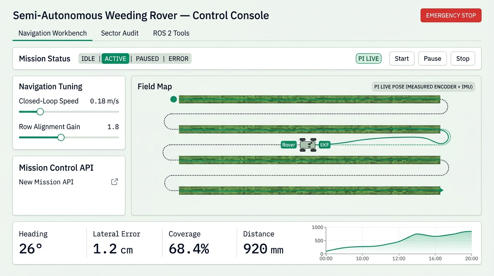
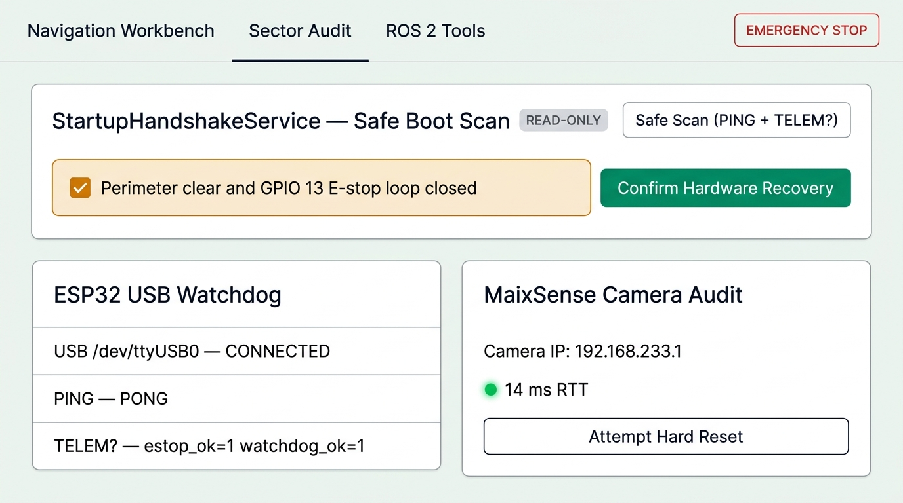
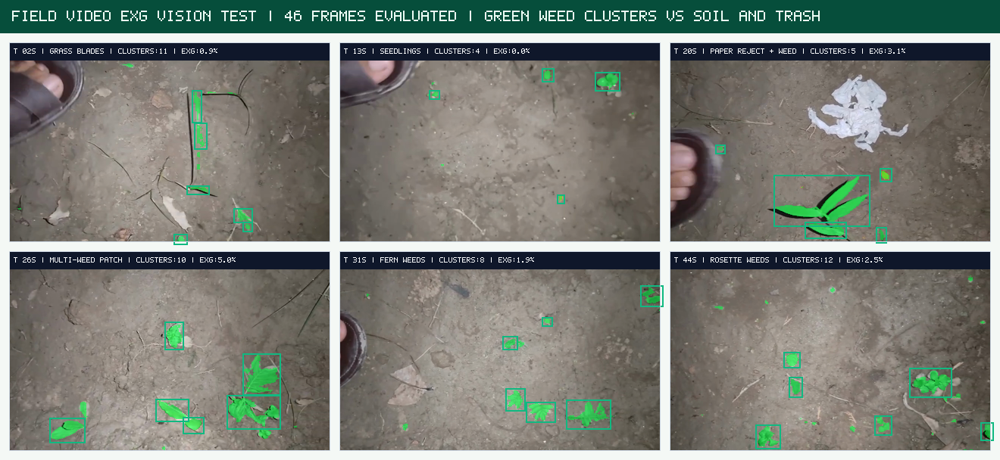

# Semi-Autonomous Weeding Robot

A hardened, fail-closed agricultural weeding rover engineered to run **all-in-one on a Raspberry Pi 4** with a USB-connected ESP32 motor/watchdog controller, BNO055 IMU, MaixSense RGB-D camera, ROS 2 action stack, and a self-hosted **React + Express Web Control Console** accessible from any phone, tablet, or Android client over the rover's Wi-Fi hotspot.

> Two hardware generations live in this repository:
> 1. **Navigation/ + Web Console + ros2_ws/** *(active focus)* — Wheeled closed-loop rover with encoder/IMU localization, hardware E-stop & watchdog interlocks, crop-row vision, modular treatment hooks, and a live web/Android control stack.
> 2. **Project-RIPRA / Weed_Detection** — Earlier gantry-on-rails vision and laser prototype.


## Contributors & Acknowledgements

### Special Thanks — AI Model Development & Electrical Systems

Special thanks to **the project collaborator reachable at [pretabinda@gmail.com](mailto:pretabinda@gmail.com)** for his substantial hands-on contributions to this project.

- **Initial AI model:** He developed the initial **six-class plant/weed model using YOLOv8n**, establishing an early multi-class recognition baseline for the project.
- **Subsequent model expansion:** The project lead later expanded the model to **nine classes using YOLO26s**. This is a later development built on the project's evolving model work.
- **Electrical system:** The electrical system was developed collaboratively. Both contributors worked together on the electrical work across the project, rather than treating it as an individual contribution.
- **Contribution history:** His work was carried out through direct collaboration and hands-on engineering, rather than GitHub commits or pull requests. Therefore, the repository's commit history does not fully represent his contribution.

We sincerely acknowledge his role in the AI model development and the jointly completed electrical-system work. Thank you for the collaboration and effort that helped move this project forward.

---

## Navigation Architecture

```text
Phone / Tablet Browser                 Android App (PiLiveClient)
        │                                         │
        ▼ (HTTP/WS :3000 on Pi 4)                 │ (HTTP :8000 + Bearer token)
┌────────────────────────────────────┐            │
│  Express Console Server (server.ts)│            │
│  - Serves built React Web App      │            │
│  - /api/robot/* authenticated proxy│            │
│  - /ws/camera live frame relay     │            │
└──────────────────┬─────────────────┘            │
                   │ (127.0.0.1:8000 + Bearer)    │
                   ▼                              ▼
┌─────────────────────────────────────────────────────────────────────────┐
│               Raspberry Pi 4 FastAPI Server (pi_server.py)              │
│  - Global `app` with FastAPI lifespan AsyncControlLoopWorker (10 Hz)    │
│  - HardenedNavigationController (thread-safe RLock)                     │
│  - CameraHealthMonitor (500 ms stale-frame fail-closed guard)           │
│  - Excess-Green Vision (crop_row_vision.py) & TargetExecutionManager    │
└──────────────────────────────────┬──────────────────────────────────────┘
                                   │
                                   ▼
┌─────────────────────────────────────────────────────────────────────────┐
│             Navigation State Machine (state_machine.py)                 │
│  - RoverStateMachine (IDLE → NAVIGATING_ROW → HEADLAND_TURN → DONE)     │
│  - FieldLocalizer (measured quadrature wheel encoders + BNO055 IMU)     │
│  - RowNavigator (3-stage closed-loop headland crossing)                 │
│  - FieldBoundaryGuard (hard polygon/margin containment)                 │
│  - MissionCheckpointTracker (pause/resume & fault recovery state)       │
└──────────────────┬──────────────────────────────┬───────────────────────┘
                   │ USB Serial (115200 baud)     │ I2C / USB-RNDIS
                   ▼                              ▼
┌────────────────────────────────────┐  ┌─────────────────────────────────┐
│  ESP32Bridge (esp32_bridge.py)     │  │  Sensors & Perception           │
│  - Single shared thread-safe UART  │  │  - BNO055 9-DOF IMU (heading)   │
│  - Wheel PID & quadrature encoders │  │  - MaixSense RGB-D / ToF camera │
│  - 250 ms serial watchdog timer    │  │  - Ultrasonic / ToF obstacle    │
│  - Physical GPIO 13 E-Stop loop    │  │    sensor (-1 invalid → FAULT)  │
└────────────────────────────────────┘  └─────────────────────────────────┘
```

### 1. Shared ESP32 Serial Bridge (`Navigation/src/esp32_bridge.py` & `Navigation/esp32_firmware/`)
- **Single Shared Bus**: Eliminates UART contention by routing all motor velocity commands, stop/E-stop packets, and sensor polling through one thread-safe `ESP32Bridge` lock (`115200` baud over USB `/dev/ttyUSB0`).
- **Text Command Protocol**:
  - `PING` → `PONG` (read-only liveness check)
  - `TELEM?` → `TELEM <left_ticks> <right_ticks> <left_rad_s> <right_rad_s> <dist_mm> <estop_ok> <watchdog_ok>`
  - `VEL <left_rad_s> <right_rad_s>` → closed-loop wheel velocity setpoints
  - `STOP` / `ESTOP` → immediate zero-PWM motor halt & hardware ACK (`OK:STOPPED` / `OK:ESTOP_LATCHED`)
  - `CLEAR_LATCH` → clears latched watchdog/E-stop state **only** when physical GPIO 13 E-stop loop is closed
  - `RESET_ENC` → zeros hardware quadrature encoder counters
- **Cold-Boot Watchdog Protection**: Boots into standby and enforces a `250 ms` serial host keepalive timeout; if Pi telemetry drops, the ESP32 cuts motor PWM and latches the watchdog fault.

### 2. Raspberry Pi FastAPI Server (`Navigation/src/pi_server.py`)
- **Ready-to-Run Global Application**: Exposes `app = create_app(...)` so `uvicorn Navigation.src.pi_server:app --host 0.0.0.0 --port 8000` boots cleanly even if the USB ESP32 cable is unplugged (remaining fail-closed until connected).
- **Lifespan Background Worker (`AsyncControlLoopWorker`)**: Continuously invokes `controller.step_control_loop()` off the asyncio event loop (`asyncio.to_thread`) at 10 Hz, keeping the ESP32 watchdog alive during idle/standby and driving closed-loop navigation during active missions.
- **API Endpoints**:

| Method & Route | Auth (`PI_API_TOKEN`) | Purpose |
|----------------|-----------------------|---------|
| `GET /health` | Public | Live controller status, worker state, encoder/IMU pose, hardware interlocks |
| `POST /start_mission` | Bearer | Enforces all 6 pre-flight launch interlocks; defaults to `nav_only=true` |
| `POST /pause` | Bearer | Zeroes wheel velocity, transitions to `PAUSED`, records mission checkpoint |
| `POST /resume` | Bearer | Resumes from `PAUSED` / `OBSTACLE_HOLD` only if camera & safety interlocks pass |
| `POST /stop` | Bearer | Dispatches ESP32 E-stop and verifies UART ACK (returns HTTP `503` if unverified) |
| `POST /recover` | Bearer | Explicit operator-confirmed recovery from `FAULT`/`ESTOP` into `PAUSED` |
| `POST /handshake` | Bearer | Safe read-only boot scan (`PING + TELEM?`) by default; `CLEAR_LATCH` strictly opt-in |
| `GET/POST /heartbeat` | Public | Lightweight keepalive ping for monitoring clients |
| `POST /camera/frame`, `POST /image` | Bearer | Raw or `multipart/form-data` frame ingestion, ExG vision analysis & Android BEV JSON |
| `GET /video_feed`, `/bev_image`, `/map_feed` | Public | Latest JPEG/PNG frame, BEV preview, and live measured-pose SVG minimap |
| `POST /calibration/homography` | Bearer | Loads & validates finite 3×3 camera-to-ground homography matrix |
| `POST /model/load` | Bearer | Path-confined verification of `.pt/.onnx/.engine/.tflite` weights inside `WEED_MODEL_DIR` |
| `POST /detections` | Bearer | Class-whitelisted, homography-gated, spatially deduplicated weed target intake |
| `POST /treatment/execute_next` | Bearer | Stationary one-shot treatment execution (blocked HTTP `412` in `nav_only` mode) |
| `GET /cut_plan` | Public | Returns validated weed target queue summary |

### 3. Navigation State Machine (`Navigation/src/state_machine.py`)
- **Authoritative States (`RoverState`)**:
  - `IDLE` — Powered standby; zero wheel commands.
  - `NAVIGATING_ROW` — Closed-loop forward tracking driven strictly by measured wheel encoder ticks (`FieldLocalizer`) + BNO055 IMU heading + visual crop-row lateral error.
  - `HEADLAND_TURN` — Three-stage closed-loop headland crossing (`RowNavigator`): 90° turn → encoder-measured furrow-width translation → 90° alignment into opposite row.
  - `TREATMENT_HOOK` — Stationary dwell window for modular weeding attachment (`TargetExecutionManager` one-shot lifecycle).
  - `OBSTACLE_HOLD` — Safe stop when ultrasonic/ToF detects an unknown obstacle (`<= 350 mm`); never blind-dodges into crop rows.
  - `PAUSED` — Operator pause or post-recovery hold with saved mission checkpoint.
  - `FAULT` — Latched fail-safe stop triggered by `-1` invalid obstacle readings, camera loss/staleness (`> 500 ms`), wheel slip residual (`> 12 cm`), boundary exit attempt (`FieldBoundaryGuard`), or UART error.
  - `ESTOP` — Latched emergency stop requiring explicit operator recovery.
  - `DONE` — All scheduled rows completed safely inside boundary margins.

---

## E-Stop & Safety Interlocks (Fail-Closed Design)

Every safety layer is designed to **fail closed** (zero motion) rather than fail open:

1. **Physical Hardware Loop (GPIO 13)**: A normally-closed physical E-stop switch wired to ESP32 GPIO 13 independently cuts motor output. Firmware refuses `CLEAR_LATCH` whenever the physical loop is open.
2. **250 ms ESP32 Serial Watchdog**: If the Pi stops polling or crashes for more than `250 ms`, the ESP32 automatically de-energizes the motor rail and latches a watchdog fault (`watchdog_ok=0`).
3. **Verified Emergency Stop ACK (`POST /stop`)**:
   - The dashboard **Emergency Stop** button dispatches a real `POST /api/robot/stop` → Pi `POST /stop` → ESP32 `ESTOP` command (never just a local UI toggle).
   - The Pi verifies an actual hardware acknowledgement (`OK:ESTOP_LATCHED` or `OK:STOPPED`). If UART times out, disconnects, or returns an unverified/simulated ACK on live hardware, the Pi enters `FAULT` and returns **HTTP `503`** warning the operator to pull the physical cutoff.
4. **Safe Boot Scan — Never Auto-Clears Latches**:
   - Opening the Web App runs `StartupHandshakeService.performSafeScan()`, which sends strictly read-only `PING + TELEM?` (`allow_clear_latch: false`, `operator_confirmed: false`).
   - Any previously latched E-stop or watchdog fault stays strictly **LOCKED** across page reloads and reboots.
5. **Mandatory Manual Hardware Recovery (`Confirm Hardware Recovery`)**:
   - Clearing a latched E-stop or watchdog fault requires the operator to check the physical perimeter/GPIO 13 confirmation box in `HardwareAuditView` and manually click **Confirm Hardware Recovery** (`allow_clear_latch: true`, `operator_confirmed: true`).
   - Recovery transitions the state machine strictly to **`PAUSED`** (`mission_active: false`) — the rover never auto-resumes movement after clearing a latch.
6. **6-Gate Pre-Flight Launch Interlock (`evaluate_launch_interlocks`)**:
   - `POST /start_mission` returns **HTTP `412`** unless: (1) live capture source (sample/demo images rejected on real hardware) + operator confirmation, (2) ESP32 USB connected, (3) `estop_ok && watchdog_ok` telemetry valid, (4) `CameraHealthMonitor` healthy (`< 500 ms` frame age), (5) obstacle sensor healthy (not `-1`), and (6) when `nav_only=false`, real detector weights loaded + calibrated 3×3 homography present.
7. **Constant-Time API Authentication**:
   - Configuring `PI_API_TOKEN` enforces constant-time `Authorization: Bearer <token>` checks (`hmac.compare_digest`) across all mutating Pi endpoints; the Express proxy attaches the token server-side so it is never exposed to browser code.

---

## Web Application UI Previews & Screenshot Placeholders

The web dashboard is self-hosted on the Raspberry Pi 4 (`port 3000`) and strictly separates **PI LIVE** mode (real measured encoder/IMU pose, simulation physics disabled) from **SIM ONLY** mode.

### NavigationWorkbench (`src/components/NavigationWorkbench.tsx`)
<!-- Image Placeholder: Replace the path below with a live Raspberry Pi 4 screenshot at docs/images/navigation_workbench_live.png once bench-tested -->

> **Live Hardware Capture Slot**: `docs/images/navigation_workbench_live.png` *(replace once captured on live Pi 4)*  
> Displays the `IDLE | ACTIVE | PAUSED | ERROR` Mission Status bar (`MissionControlService`), `PI LIVE POSE` vs. `LOCAL SIMULATION ONLY` map badge, closed-loop field trajectory, real-time lateral error chart, and row-end detection alerts.

### HardwareAuditView (`src/components/HardwareAuditView.tsx`)
<!-- Image Placeholder: Replace the path below with a live Raspberry Pi 4 screenshot at docs/images/hardware_audit_view_live.png once bench-tested -->

> **Live Hardware Capture Slot**: `docs/images/hardware_audit_view_live.png` *(replace once captured on live Pi 4)*  
> Displays `StartupHandshakeService` safe read-only boot scan (`PING + TELEM?`), the mandatory **Confirm Hardware Recovery** operator latch-clear gate, MaixSense LAN/USB-RNDIS discovery, real-time green/yellow/red ping latency pulse indicator, RTSP/MJPEG stream reconnect, and **Attempt Hard Reset**.

---

## Automated Test Suite

Run the full automated verification suite (zero physical hardware required):

```bash
python3 -m unittest Navigation/tests/test_navigation_audit.py Navigation/tests/test_field_video_vision.py -v
```

### Core 22 Navigation, Firmware, Safety & API Audit Tests (`Navigation/tests/test_navigation_audit.py`)

| # | Test Function | What It Verifies |
|---|---------------|------------------|
| 1 | `test_nav01_nav02_closed_loop_encoder_and_imu_turn` | Encoder-based `FieldLocalizer` translation + BNO055 IMU heading-driven turn accuracy |
| 2 | `test_nav03_nav10_slip_fault_and_explicit_relocalization` | Wheel slip residual fault detection (`> 12 cm`) and explicit landmark re-localization recovery |
| 3 | `test_nav05_invalid_sensor_reading_enters_fault_and_stops` | Invalid `-1` ultrasonic/ToF reading halts motion immediately into `FAULT` and blocks plain resume |
| 4 | `test_nav06_single_shared_esp32_bridge` | Single shared thread-safe `ESP32Bridge` bus without serial port contention |
| 5 | `test_nav08_field_boundary_guard_blocks_exit` | `FieldBoundaryGuard` prevents rover from crossing perimeter safety margins |
| 6 | `test_nav09_unknown_obstacle_safe_hold_no_autododge` | Unknown obstacle triggers `OBSTACLE_HOLD` stop without blind crop-damaging avoidance |
| 7 | `test_nav04_nav07_nav11_nav12_full_serpentine_coverage_and_checkpoint` | Full serpentine multi-row mission, 3-stage headland turns, coverage tracking & pause/resume checkpointing |
| 8 | `test_hw06_hw07_firmware_validation_and_watchdog` | ESP32 firmware safety protocol validation, command parsing, and 250 ms serial watchdog |
| 9 | `test_audit26_1a_no_virtual_pose_without_physical_encoders` | Zero virtual pose advancement when physical wheel encoder ticks do not change |
| 10 | `test_audit26_1c_camera_failure_causes_immediate_stop_no_blind_move` | Missing or stale (`> 500 ms`) camera feed immediately stops motors into `CAMERA_LOSS` fault |
| 11 | `test_audit26_1d_3c_3d_one_shot_target_lifecycle_and_crop_rejection` | One-shot weed actuation lifecycle, spatial deduplication, homography projection & protected `crop_*` rejection |
| 12 | `test_audit26_1e_estop_latch_and_unverified_ack_returns_503` | E-stop latching and strict HTTP `503` fail-closed response when ESP32 UART ACK cannot be verified |
| 13 | `test_audit26_2b_2c_3a_launch_interlocks_and_sample_image_guard` | Pre-flight launch interlock blocking (`412`) and rejection of sample/demo images on live hardware |
| 14 | `test_audit_c_cold_boot_standby_and_explicit_watchdog_recovery` | ESP32 cold-boot standby behavior and operator-confirmed watchdog latch recovery |
| 15 | `test_audit_b_camera_ingestion_visual_row_end_and_background_worker` | Live frame ingestion, visual row-end confidence routing, and background control-loop worker ticks |
| 16 | `test_audit_d_imu_heading_wired_into_navigation_stack` | BNO055 IMU driver integration inside `build_navigation_stack()` |
| 17 | `test_audit_e_ros2_colcon_workspace_manifests_and_collision_monitor_wiring` | ROS 2 package manifests, setup entry points, and Nav2 Collision Monitor bringup configuration |
| 18 | `test_audit_f_detections_remain_fail_closed_until_calibrated_and_loaded` | Detection intake fails closed (`412`) until model weights are loaded and 3×3 homography is calibrated |
| 19 | `test_startup_handshake_read_only_never_clears_latch_automatically` | Read-only startup handshake (`PING + TELEM?`) never auto-clears tripped latches; explicit operator recovery stays `PAUSED` |
| 20 | `test_startup_handshake_unlocks_dispatch_when_camera_healthy` | Navigation dispatch gate unlocks only when ESP32 ready-state AND live camera health both pass |
| 21 | `test_async_control_loop_worker_drives_mission_continuously` | FastAPI lifespan `AsyncControlLoopWorker` drives closed-loop mission ticks continuously |
| 22 | `test_global_app_boot_survives_unplugged_usb_esp32_fail_closed` | Global FastAPI `app` boots safely with USB ESP32 unplugged while keeping launch interlocks fail-closed (`412`) |

### Additional Hardening & Real Field-Video Tests (**7 Extra Tests → 29 / 29 Total PASS**)

| # | Test Function | File | What It Verifies |
|---|---------------|------|------------------|
| 23 | `test_crop_row_vision_computes_row_end_and_lateral_error` | `test_navigation_audit.py` | Excess-Green (`ExG`) crop-row vs. headland row-end confidence & lateral error extraction |
| 24 | `test_multipart_image_upload_extraction_for_android_client` | `test_navigation_audit.py` | Stdlib `multipart/form-data` image extraction & Android BEV JSON response fields |
| 25 | `test_load_weed_model_path_confinement_and_verification` | `test_navigation_audit.py` | Directory traversal rejection (`403`), extension allowlist, and real weights file verification |
| 26 | `test_execute_next_treatment_target_enforces_interlocks_and_stationary_stop` | `test_navigation_audit.py` | Stationary stop + HTTP `412` interlock blocking when `nav_only`, uncalibrated, or actuator missing |
| 27 | `test_bearer_token_authentication_verification` | `test_navigation_audit.py` | Constant-time `Authorization: Bearer <PI_API_TOKEN>` enforcement |
| 28 | `test_ros2_row_follow_action_server_structure` | `test_navigation_audit.py` | Real ROS 2 `FollowCropRow.action` & `rclpy.action.ActionServer` + `MultiThreadedExecutor` wiring |
| 29 | `test_real_outdoor_field_video_exg_pipeline` | `test_field_video_vision.py` | 46-frame outdoor soil/weed MP4 video ExG vision test & debris rejection |

---

## Real Outdoor Field-Video Vision Test & Simulator Demo



- Evaluated `crop_row_vision.py` → `HardenedNavigationController.ingest_camera_frame()` across **46 sampled frames (1 fps)** from `public/assets/aistudio/WhatsApp_Video_2026-11-21_at_3.47.13_PM_167ebba9.mp4`: **46/46 decoded**, **371 green vegetation clusters localized**, and crumpled white paper trash (`t = 20 s`) cleanly rejected (`green_ratio_far = 0.0008`). Full report saved in `docs/field_video_test_report.json`.
- **Virtual Field Simulator**: [field_sim_mission.mp4](Navigation/sim/field_sim_mission.mp4) | [rover_weeding_anim.mp4](Navigation/sim/rover_weeding_anim.mp4)


---

## All-in-One Deployment on Raspberry Pi 4

Both the Python navigation server (`:8000`) and production web dashboard (`:3000`) run directly on the **Raspberry Pi 4**—no PC or cloud server needed in the field:

```bash
# 1. Start Raspberry Pi Navigation & Vision API (port 8000)
export PI_API_TOKEN="choose-a-strong-shared-secret"
export WEED_MODEL_DIR="/home/pi/models"
uvicorn Navigation.src.pi_server:app --host 0.0.0.0 --port 8000

# 2. Build & Serve Web Console in Production Mode (port 3000)
npm install
npm run build
NODE_ENV=production \
  PI_ROBOT_URL="http://127.0.0.1:8000" \
  PI_API_TOKEN="choose-a-strong-shared-secret" \
  npx tsx server.ts

# 3. Start MaixSense Camera Bridge on the same Pi 4
python3 scripts/maixsense_bridge.py --server ws://127.0.0.1:3000/ws/camera --room rover-01
```

Connect from your phone/tablet over the Pi 4 Wi-Fi hotspot (`http://<pi4-ip>:3000` for Web App, or `http://<pi4-ip>:8000` for Android App).

### Staged Bench-to-Field Bring-Up Order
1. **Motor Power OFF**: Confirm Safe Boot Scan (`PING + TELEM?`), live USB ESP32 telemetry, and MaixSense stream.
2. **Wheels Off the Ground (Rover on Stand)**: Verify physical GPIO 13 E-stop stops motors, test **Confirm Hardware Recovery**, confirm encoder tick signs and IMU yaw direction, and verify camera unplug triggers `CAMERA_LOSS` within `0.5 s`.
3. **Slow Ground Test (`Nav-Only` Mode)**: Keep `nav_only=true` and speed `0.10–0.15 m/s` on flat ground with physical E-stop in reach before ever calibrating homography or enabling physical treatment hardware.
