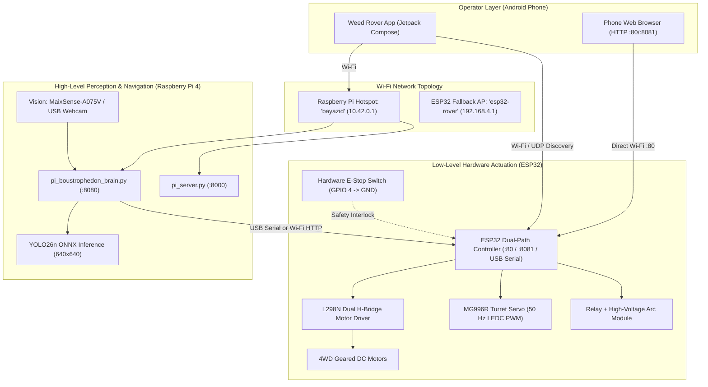
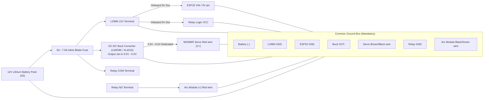

# Semi-Autonomous Weed Laser & Arc Rover — System Architecture

This document details the end-to-end architecture of the robotic system, covering power distribution, electrical wiring, communication protocols, computing layers, safety interlocks, and repository file locations.

---

## 1. High-Level System Overview



---

## 2. Power Distribution & Electrical Architecture



> [!CAUTION]
> **Power Safety Rules:**
> 1. **Dedicated Servo Rail**: Never power an MG996R from the ESP32 5V pin or L298N onboard regulator. Its 2.5A peak stall current will blow the regulator or brown-out the ESP32.
> 2. **Voltage Pre-Check**: Always measure buck converter output with a multimeter and adjust to **5.5V–6.0V** *before* connecting the servo.
> 3. **Inline Fuse**: Place a 5A–7.5A fuse directly on the 12V battery positive lead to protect against short circuits.

---

## 3. ESP32 Pinout & Signal Mapping

| ESP32 Pin | Connected Device | Direction | Purpose / Specifications |
| :--- | :--- | :--- | :--- |
| **GPIO 27** | L298N `ENA` | OUTPUT | Left motors PWM speed control (Remove jumper cap!) |
| **GPIO 25** | L298N `IN1` | OUTPUT | Left motors direction forward |
| **GPIO 26** | L298N `IN2` | OUTPUT | Left motors direction reverse |
| **GPIO 14** | L298N `ENB` | OUTPUT | Right motors PWM speed control (Remove jumper cap!) |
| **GPIO 32** | L298N `IN3` | OUTPUT | Right motors direction forward |
| **GPIO 33** | L298N `IN4` | OUTPUT | Right motors direction reverse |
| **GPIO 15** | MG996R Servo Signal | OUTPUT | 50 Hz PWM turret steering (-30° to +30°) |
| **GPIO 18** | Relay Signal (`IN`) | OUTPUT | Active-HIGH Arc module trigger (capped at 2000 ms) |
| **GPIO 4** | E-Stop Switch | INPUT | `INPUT_PULLUP`. **Must connect to GND** to operate! |
| **GND** | System Ground | POWER | Common Ground reference with Battery, L298N, Buck, Servo |
| **VIN / 5V** | Regulated 5V In | POWER | Powered from clean 5V rail |

---

## 4. Dual-Path Communication Protocol

The robot supports two parallel control pathways:

### Path A: Full Autonomous / Assisted Mode (Phone $\rightarrow$ Pi Hub $\rightarrow$ ESP32)
1. Phone connects to Pi Wi-Fi hotspot `bayazid` (`10.42.0.1`).
2. App reads live annotated camera feed from `GET http://10.42.0.1:8080/api/frame.jpg`.
3. App sends 8-way commands to `POST http://10.42.0.1:8080/api/dir` with token `12345678`.
4. Pi forwards commands to ESP32 either over **USB Serial (`/dev/ttyUSB0` at 115200 baud)** or over **Wi-Fi (`http://10.42.0.242/cmd`)**.

### Path B: Direct Hardware Mode (Phone $\rightarrow$ ESP32)
1. Phone connects directly to ESP32 hotspot `esp32-rover` (`192.168.4.1`) or local IP (`10.42.0.242`).
2. Browser opens `http://192.168.4.1/` (Port 80) for instant touch D-pad, servo slider, and arc buttons.
3. App sends low-latency commands directly to `http://<esp32-ip>:8081/cmd?q=<command>`.

---

## 5. Software & Firmware Stack

```mermaid
classDiagram
    class AndroidApp {
        +SimplaControlScreen.kt (Manual 8-way, Servo, Arc, Live HUD)
        +BeMainScreen.kt (Field Photo Upload, Furrow Mapping, Mission Launch)
        +WifiNetworkBinder.kt (Hotspot Auto-Routing)
    }

    class PiBrain {
        +pi_boustrophedon_brain.py (Port 8080, FastAPI)
        +onnx_detector.py (YOLO26n 2-class: crop=0, weed=1)
        +fetch_maixsense() (MaixSense ToF + USB Webcam fallback)
        +_esp32_monitor_loop() (Async background ESP32 discovery)
    }

    class ESP32Firmware {
        +esp32_motor_controller.ino (C++ Arduino Core)
        +WebServer :80 & :8081
        +DNSServer Captive Portal
        +50Hz LEDC PWM Servo Driver
        +Arc Safety Watchdog
    }

    AndroidApp --> PiBrain : HTTP REST / MJPEG
    AndroidApp --> ESP32Firmware : HTTP REST / UDP :8082
    PiBrain --> ESP32Firmware : USB Serial / HTTP REST
```

---

## 6. Repository File Locations

- **ESP32 Firmware**:
  - Arduino IDE / CLI Sketch: `simpla_bot/firmware/esp32_motor_controller/esp32_motor_controller.ino`
  - Firmware Root: `simpla_bot/firmware/esp32_motor_controller.ino`
- **Raspberry Pi Brain & AI**:
  - Perception & Control Runtime: `weed_detection_bot/pi_brain/pi_boustrophedon_brain.py`
  - Lightweight ONNX Detector: `weed_detection_bot/pi_brain/onnx_detector.py`
  - Trained Model Weights: `weed_detection_bot/yolo_models/yolo26n_best.onnx`
  - Mission & Navigation Server: `Navigation/src/pi_server.py`
- **Android Application**:
  - Simpla Robot Control Screen: `android_app/app/src/main/java/com/weedlaser/bev/presentation/SimplaControlScreen.kt`
  - BEV Planner Screen: `android_app/app/src/main/java/com/weedlaser/bev/presentation/BeMainScreen.kt`
  - Compiled Debug APK: `android_app/app/build/outputs/apk/debug/app-debug.apk`
