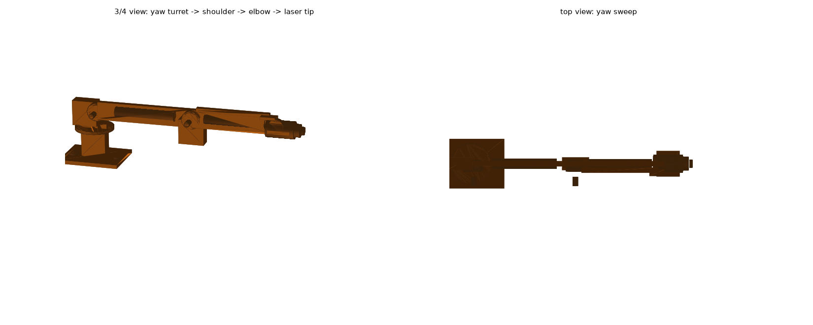

# 3-DOF laser arm (mechanical)

Solid model of the arm that points the weed-killing laser. Built with the
FreeCAD script `make_arm.py` (headless: `./FreeCAD.AppImage -c make_arm.py`),
committed here as full assembly STL + 28 named STEP parts for printing /
CAM / mating to the rover deck.

## Layout (values in mm, origin = deck mount plate centre, +X forward)

| Stage | Axis | Partner part | Details |
|---|---|---|---|
| 1. Turret | **yaw** about Z | MG996R (43×20×42, 25T horn) | under a Ø64×5 rotating plate, brace across |
| 2. Shoulder | **pitch** about Y | DS3218 (42×20×40, 20 kg·cm) | shaft at (7, ±14, 84); horn + idler hub clamp the link |
| 3. Elbow | **pitch** about Y | DS3218 | hangs under the upper-link end face at x=167 |
| Tip | — | 445 nm 2 W laser module | Ø14×46 clamp ring, lens ring, cable channel run |

- Deck mount plate 100×80×6 (two M8 bosses for the rover deck bolts).
- Upper link 160 mm, forearm 140 mm — both 8 mm thick bars with lightening
  channels and cable channel on top of the forearm.
- Assembly bounds: X −50…351, Y ±40, Z 0…106.
- **Laser tip sits 351 mm forward of the yaw axis, 78 mm above the deck** in
  the neutral (horizontal) pose.

## Coverage / kinematics

- Pivot height 84 mm + L1 160 + L2 140 → pitching the shoulder ~25° down and
  the elbow ~0° puts the tip on the ground ~285 mm ahead of the turret — that
  is the actual weeding pose (tip 285–350 mm ahead, can hit 0–84 mm height).
- Yaw sweep ±90° covers one full lane width without repositioning the rover.

## Servo load check (static, horizontal pose ≈ worst case)

| Joint | Load | |  Torque |
|---|---|---|---|
| Shoulder | links 48 g + 42 g, elbow servo 60 g, laser head ~100 g at r = 8/24/16/31 cm | | ≈ 0.53 N·m ≈ **5.4 kg·cm** → DS3218 (20 kg·cm) w/ ~4× margin |
| Elbow | forearm 42 g + laser head 100 g at 7/31 cm... ( forearm 7 cm avg) | | ≈ 0.35 N·m ≈ **3.6 kg·cm** → comfortable |
| Yaw | whole arm ~0.30 kg at ~17 cm mean radius | | ≈ 0.05 kg·m ≈ **5 kg·cm** (drag dominated) → MG996R (11 kg·cm) OK |

## Electrical interface (matches `docs/electrical/weed_rover_electrical`)

- `PWM_YAW` / `PWM_SH` / `PWM_EL` — 50 Hz PWM from the ESP32 (U2).
- Servo power from the **dedicated 6 V UBEC (U15, 10 A)** on the `+6VS` rail —
  never from the Pi's 5 V rail (stall spikes would brown-out the SBC).
- Laser head wiring runs through the forearm cable channel to the laser
  driver (U7) with the dual interlock (Pi `LASER_EN` AND key `LASER_ON_HW`).

## BOM

- 1× MG996R (yaw), 2× DS3218 (shoulder, elbow)
- 1× 445 nm 2 W laser module w/ TTL driver (the D1 in the schematic)
- Printed or laser-cut links: 6 mm plate or 2020-profile adapters
- M3 hardware throughout, M8 deck bolts
